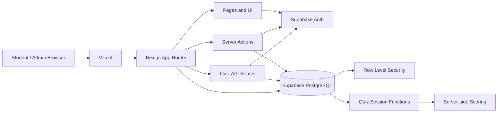
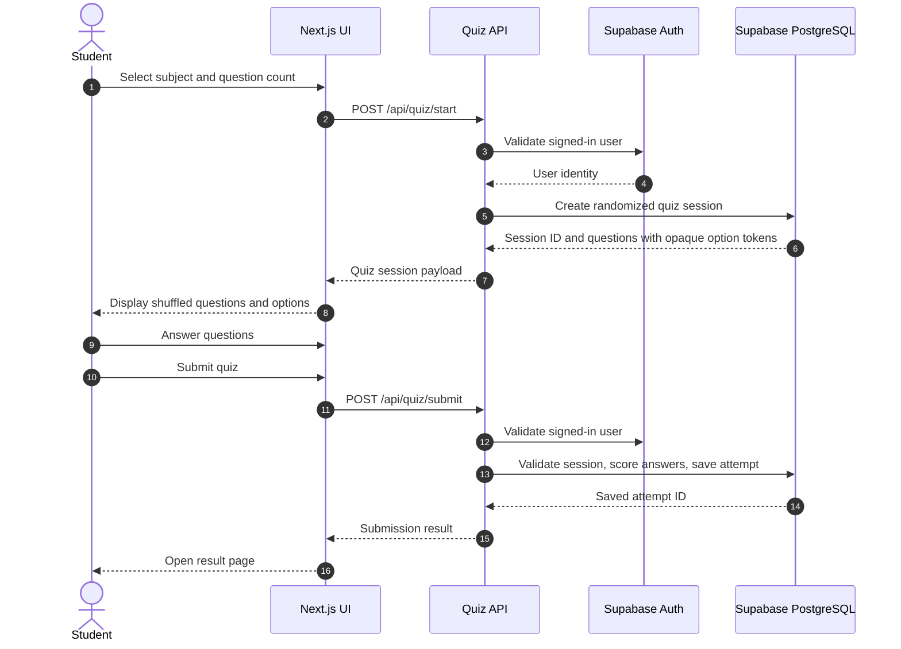

# 🎓 CU Quiz

> **A student-built MCQ practice platform for Chandigarh University.**

**Made by the students of CU for the students of CU.**

CU Quiz brings subject-wise practice, randomized questions, shuffled answer options, progress tracking, and saved results into one simple workspace. Students choose how many questions to attempt; admins keep the question bank up to date.

[](https://cu-quiz-platform.vercel.app/)
[](https://github.com/RajCodes2006/quiz-maker/actions/workflows/ci.yml)
[](https://nextjs.org/)
[](https://react.dev/)
[](https://www.typescriptlang.org/)
[](https://supabase.com/)

---

## 🌐 Live

| Service | Link |
|---|---|
| 🌐 **Web Application** | [https://cu-quiz-platform.vercel.app](https://cu-quiz-platform.vercel.app) |
| 💻 **GitHub Repository** | [https://github.com/RajCodes2006/quiz-maker](https://github.com/RajCodes2006/quiz-maker) |
| ⚙️ **Application API** | Next.js route handlers hosted with the web app |

There is no separate backend service to deploy. The Next.js application, server actions, and API routes run on Vercel.

---

## 🎯 What This Project Solves

Preparing for university subjects often means switching between notes, question banks, and manual progress tracking.

CU Quiz provides one place to:

- Practise MCQs by subject.
- Attempt a quiz with a chosen question count.
- Get a fresh randomized question set and option order.
- Move between questions and track completion.
- Submit answers for server-side evaluation.
- Review saved attempts and scores.

Admins can create subjects, add four-option MCQs, and import question banks in bulk.

---

## ✨ Core Capabilities

### 🧑‍🎓 Student Workspace

- Register and sign in using email and password.
- Sign in with Google through Supabase Auth.
- View active subjects and recent quiz attempts.
- Open a subject and choose from **10, 20, 40, or 80 questions**, based on the available published question bank.
- Receive a randomized question selection and shuffled option order for each quiz.
- Answer one question at a time with previous/next navigation.
- Track progress and answered questions.
- Submit the quiz and view the saved result.

### 📝 Quiz Experience

The quiz flow is designed to keep the question bank and answer keys on the server.

- Questions are selected on the server from the published subject bank.
- The order of questions and the order of options are randomized for a quiz session.
- The browser receives opaque option tokens, not correct-answer values.
- Every question must be answered before submission.
- Quiz sessions are single-use and expire.
- Scoring and result creation happen server-side.

### 🛠️ Admin Workspace

- Role-protected admin dashboard.
- Create subjects and provide descriptions.
- Add MCQs with four options and a correct option.
- Import question banks using CSV.
- Review the current subject list and question-bank totals.

**CSV import limits:** maximum file size of **1 MB** and maximum of **500 question rows** per upload. The full batch is validated before it is inserted.

### 🔐 Authentication & Roles

- Supabase Authentication for email/password and Google OAuth.
- New registrations receive the student role.
- Admin privileges are assigned directly in the database.
- Server-side role checks protect admin pages and actions.
- Authenticated users can access only their own saved quiz results.

---

## 🧠 System Architecture

CU Quiz uses a single Next.js application with Supabase providing authentication and PostgreSQL storage.



### Main application layers

| Layer | Responsibility |
|---|---|
| Next.js App Router | Pages, layouts, server rendering, and route handling |
| React UI | Student dashboard, quiz interface, login, and admin workspace |
| Server Actions | Authentication flows and admin mutations |
| Quiz API routes | Start quiz sessions and accept quiz submissions |
| Supabase Auth | User identity, sessions, and OAuth |
| Supabase PostgreSQL | Profiles, subjects, question bank, sessions, attempts, and responses |
| Row Level Security | Restrict database access by role and ownership |
| Vercel | Hosts the complete Next.js application |

---

## 🔄 Quiz Attempt Flow



### Quiz endpoints

| Method | Endpoint | Purpose |
|---|---|---|
| `POST` | `/api/quiz/start` | Validates the request and creates a server-issued quiz session |
| `POST` | `/api/quiz/submit` | Validates answers and submits a session for server-side scoring |

Both endpoints require an authenticated user. They also enforce same-origin request checks, JSON content-type validation, request-body size limits, and rate limits.

---

## 🔐 Security Architecture

Security controls exist at both the application and database layers.

### Application protections

- Server-side authentication and admin-role verification.
- Database-backed rate limiting for sign-in, signup, quiz, and admin operations.
- Hashed rate-limit identifiers instead of storing raw email addresses or IP addresses.
- Same-origin validation for quiz API requests.
- JSON content-type and streamed request-size validation.
- Single-use, expiring quiz sessions.
- Ownership checks before showing saved attempt results.
- Correct answers are never sent to the student-facing quiz interface.
- The Supabase secret key is restricted to server-side code.

### Database protections

- Row Level Security enabled on application tables.
- Explicit grants and role-specific policies.
- Students cannot directly read the questions or answer-key tables through the Supabase Data API.
- Quiz session and scoring functions validate the session and submitted option tokens.
- Rate-limit counters are stored in a server-only schema and accessed through a restricted database function.
- Unnecessary table and sequence privileges are revoked.

### HTTP security

Production responses include security headers such as:

- Nonce-based Content Security Policy.
- HTTP Strict Transport Security (HSTS).
- `X-Frame-Options: DENY`.
- `X-Content-Type-Options: nosniff`.
- Strict referrer policy and restricted browser permissions.

**Security note:** Automated tests and hardening checks do not replace an independent penetration test. Enable Supabase leaked-password protection in the Auth settings when it is available on your project plan.

---

## 🏗️ Project Structure

```text
quiz-maker/
├── .github/
│   ├── dependabot.yml
│   └── workflows/
│       └── ci.yml
│
├── app/
│   ├── admin/
│   │   ├── actions.ts
│   │   └── page.tsx
│   ├── api/
│   │   └── quiz/
│   │       ├── start/route.ts
│   │       └── submit/route.ts
│   ├── auth/
│   │   └── callback/route.ts
│   ├── dashboard/page.tsx
│   ├── login/
│   │   ├── auth-panel.tsx
│   │   ├── google-sign-in-button.tsx
│   │   └── page.tsx
│   ├── quiz/
│   │   └── [subjectId]/
│   │       ├── page.tsx
│   │       └── quiz-client.tsx
│   ├── result/
│   │   └── [attemptId]/page.tsx
│   ├── actions.ts
│   ├── globals.css
│   └── layout.tsx
│
├── components/
│   └── theme-toggle.tsx
│
├── lib/
│   ├── auth.ts
│   ├── csv.ts
│   ├── http.ts
│   ├── rate-limit.ts
│   └── supabase/
│       ├── admin.ts
│       ├── client.ts
│       ├── env.ts
│       ├── proxy.ts
│       └── server.ts
│
├── public/
│   └── question-template.csv
│
├── supabase/
│   ├── schema.sql
│   ├── security-hardening.sql
│   └── tests/
│       ├── quiz-session-smoke.sql
│       └── security-hardening-smoke.sql
│
├── tests/
│   ├── csv.test.mjs
│   └── security.test.mjs
│
├── .env.example
├── next.config.ts
├── package.json
├── proxy.ts
└── README.md
```

---

## 🛠️ Tech Stack

| Layer | Technology |
|---|---|
| Framework | Next.js 16 |
| UI | React 19 |
| Language | TypeScript |
| Styling | CSS |
| Authentication | Supabase Auth |
| Database | Supabase PostgreSQL |
| Database access control | PostgreSQL RLS and explicit grants |
| Server-side data access | Supabase JavaScript client |
| Hosting | Vercel |
| Analytics | Vercel Analytics |
| Performance monitoring | Vercel Speed Insights |
| CI | GitHub Actions |
| Dependency updates | Dependabot |

---

## 🚀 Run Locally

### Requirements

- Node.js **22 or later**
- npm
- A Supabase project

### 1. Clone the repository

```bash
git clone https://github.com/RajCodes2006/quiz-maker.git
cd quiz-maker
```

### 2. Install dependencies

```bash
npm install
```

### 3. Configure environment variables

Copy the example file:

```bash
cp .env.example .env.local
```

Add your Supabase project values:

```env
NEXT_PUBLIC_SUPABASE_URL=https://your-project-ref.supabase.co
NEXT_PUBLIC_SUPABASE_PUBLISHABLE_KEY=your-supabase-publishable-key
NEXT_PUBLIC_SITE_URL=http://localhost:3000

# Server-only key. Never expose this in browser code.
SUPABASE_SECRET_KEY=your-supabase-secret-key
```

| Variable | Description |
|---|---|
| `NEXT_PUBLIC_SUPABASE_URL` | Supabase project URL |
| `NEXT_PUBLIC_SUPABASE_PUBLISHABLE_KEY` | Supabase publishable key used by the browser client |
| `NEXT_PUBLIC_SITE_URL` | Base URL used for authentication redirects |
| `SUPABASE_SECRET_KEY` | Server-only key for trusted server operations |

**Never** prefix the secret key with `NEXT_PUBLIC_` or commit real credentials to GitHub.

### 4. Set up the database

Open the Supabase SQL Editor and run these files in order:

1. `supabase/schema.sql`
2. `supabase/security-hardening.sql`

The first file creates the application schema and core database functions. The second applies additional privilege restrictions, server-only rate limiting, and security policies.

For an existing project, review the migration before running it. Do not disable RLS to resolve permission errors.

### 5. Start the development server

```bash
npm run dev
```

Open [http://localhost:3000](http://localhost:3000).

---

## 🔑 Configure Authentication

### Email and password

In Supabase Dashboard → Authentication:

1. Set the **Site URL** to your app URL.
2. Configure email confirmation as required.
3. Add the callback URL to the allowed redirect URLs:
   - Local: `http://localhost:3000/auth/callback`
   - Production: `https://cu-quiz-platform.vercel.app/auth/callback`

Add any preview URLs that you intend to use.

### Google sign-in

1. Create an OAuth client in Google Cloud Console.
2. Add the Supabase callback URL to the Google OAuth client's authorized redirect URIs:

   ```text
   https://<your-project-ref>.supabase.co/auth/v1/callback
   ```

3. In Supabase Dashboard → Authentication → Providers, enable **Google**.
4. Enter the Google OAuth client ID and client secret.
5. Add your local and production app callback URLs to Supabase's allowed redirect URLs.

The application starts Google OAuth from the current app origin and handles the return through `/auth/callback`.

---

## 👑 Create the First Admin

Every public registration creates a student account. To promote an account, run this query in the Supabase SQL Editor:

```sql
UPDATE public.profiles
SET role = 'admin'
WHERE id = (
  SELECT id
  FROM auth.users
  WHERE email = 'your-admin-email@example.com'
);
```

Replace the email address with the account you want to promote. Then sign out and sign in again.

- Admin accounts are routed to `/admin`.
- Student accounts are routed to `/dashboard`.

Admin promotion should remain a database-owner operation. Do not add role selection to the public signup form.

---

## 📥 Bulk Import Questions

Admins can import questions from the admin workspace using a CSV file.

The CSV must contain these exact headers:

```csv
question_text,option_a,option_b,option_c,option_d,correct_option
```

Example:

```csv
question_text,option_a,option_b,option_c,option_d,correct_option
"What is the time complexity of binary search?","O(n)","O(log n)","O(n log n)","O(1)",B
```

Import rules:

- Every row must contain a question and all four options.
- `correct_option` must be `A`, `B`, `C`, or `D`.
- Maximum file size: **1 MB**.
- Maximum import size: **500 question rows**.
- Invalid rows are reported and the batch is not partially imported.

Download the [CSV question template](public/question-template.csv).

---

## 🧪 Tests & Quality Checks

Run these commands before submitting changes:

```bash
npm test
npm run typecheck
npm run build
npm audit --audit-level=moderate
```

### Automated checks

GitHub Actions runs the following checks on pushes and pull requests targeting `main`:

1. Install the locked dependency tree.
2. Audit dependencies for vulnerabilities at the moderate level or higher.
3. Run regression and security tests.
4. Run the TypeScript compiler.
5. Build the production application.

Dependabot checks npm dependencies and GitHub Actions updates weekly.

### Database smoke tests

SQL smoke tests are available in `supabase/tests/`:

| File | Purpose |
|---|---|
| `quiz-session-smoke.sql` | Checks quiz-session database behavior |
| `security-hardening-smoke.sql` | Checks privilege, RLS, and rate-limit protections |

---

## ☁️ Deployment

CU Quiz is deployed as a single Next.js project on Vercel.

### Deploy to Vercel

1. Import [the GitHub repository](https://github.com/RajCodes2006/quiz-maker) into Vercel.
2. Add the four environment variables from the local setup section.
3. Set `NEXT_PUBLIC_SITE_URL` to the production URL.
4. Add the production and required preview `/auth/callback` URLs to Supabase Auth's allowed redirect URLs.
5. Deploy the `main` branch.

Vercel builds and hosts the Next.js pages, server actions, and quiz API route handlers. No separate Render service is required.

---

## 📌 Important Notes

- The question and answer-key tables are not intended for direct student-side querying.
- Correct answers must remain server-side; do not include answer keys in client components or API responses.
- Run both SQL files when setting up a new database.
- Keep the Supabase secret key out of source control and browser bundles.
- Keep Supabase Auth redirect URLs synchronized with local, production, and preview domains.
- Review Dependabot updates and keep dependencies current.
- Application hardening and CI checks are useful safeguards, not a guarantee that the system is free of vulnerabilities.

---

## 🤝 Contributing

1. Fork the repository.
2. Create a feature branch.
3. Make your changes.
4. Run tests, type checks, and a production build.
5. Open a pull request with a clear summary.

```bash
git checkout -b feature/your-feature
git add .
git commit -m "feat: describe your change"
git push origin feature/your-feature
```

---

## 🎓 CU Quiz

**Made by the students of CU for the students of CU.**

[Open the Live App →](https://cu-quiz-platform.vercel.app/)

[View the GitHub Repository →](https://github.com/RajCodes2006/quiz-maker)
